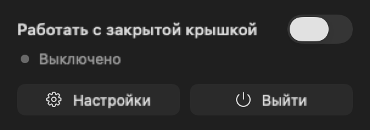
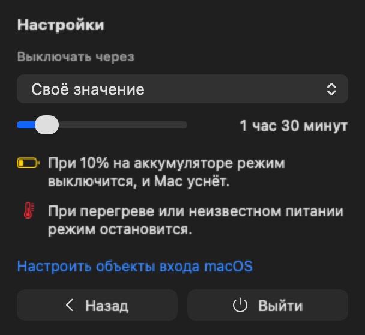
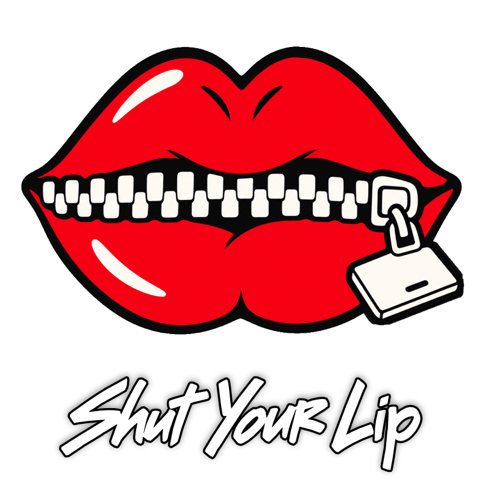

<p align="center"></p>
<h1 align="center">Shut Your Lid</h1>
<p align="center"><strong>Close your MacBook. Keep things running.</strong><br>A small, local macOS menu bar app with a little attitude.</p>
<p align="center">macOS 14+ · Apple Silicon & Intel · Russian & English · Open source</p>

<p align="center"><a href="https://github.com/artematman/shut-your-lid/releases/download/v0.3.9-rc.1/Shut-Your-Lid-0.3.9-universal.dmg"><strong>Download for macOS — DMG</strong></a> · <a href="docs/INSTALL.md">Installation guide</a> · <a href="https://github.com/artematman/shut-your-lid/releases/tag/v0.3.9-rc.1">Release notes & checksums</a></p>

> **Public prerelease · 0.3.9 build 17.** Free download, no account required. Developer ID signed, accepted by Apple notarization and stapled. Clean-system helper and physical battery/thermal/lid acceptance remain pending; this is a version for testing, not a stable release.

## One switch. Your time.

Keep your MacBook working with its lid closed for a duration you choose. Launching from the Dock shows the centered lips animation, which folds away into the menu bar. Click the laptop in the menu bar to turn the mode on; settings stay on their own page. The confirmed deadline appears below the switch.

- **Your duration:** 30 minutes through 12 hours, or any whole minute with the custom slider. Four hours is the initial default.
- **Change it while running:** a duration change starts the selected remaining time from that change, after the system helper confirms it.
- **Battery guard:** at 10% or lower on battery, the app restores ordinary sleep and asks your Mac to sleep. Normal checks run every 10 seconds.
- **Temperature guard:** serious overheating or unavailable power information stops the mode.
- **A proper welcome:** the approved lips blow a kiss and zip shut; in the graffiti marker wordmark the last “d” tips over and lands as a “p” — “Shut Your Lip.” The first launch then points out the menu bar control; later launches fold straight into it.
- **Native controls:** Liquid Glass on macOS 26+, with a material fallback on older supported systems, accessible controls and reduced motion support.
- **Automatic language:** Russian when Russian is the first preferred macOS language; English otherwise.

## A look inside

<p align="center"> </p>
<p align="center"> </p>

The cover is a promotional MacBook mockup. Interface images below are native view renders using demonstration state; the live panel uses the system’s glass material. No personal desktop content or system logs are included.

## Install on another Mac

Download the signed [0.3.9 candidate disk image](https://github.com/artematman/shut-your-lid/releases/download/v0.3.9-rc.1/Shut-Your-Lid-0.3.9-universal.dmg), open it and drag **Shut Your Lid** to **Applications**. Launch it from Applications or keep it in your Dock. See the [installation guide](docs/INSTALL.md) for first launch, updates and removal.

The first time you enable the mode, macOS requests approval for its background helper. Open **System Settings → General → Login Items & Extensions** and approve the item belonging to Shut Your Lid. macOS can show the signing developer’s name. Return to the app and try the switch again.

Each Mac has its own approval and local state. No developer account, password, signing key or shared settings are installed on the recipient’s computer.

If another utility already changes closed-lid sleep behavior, turn off that utility’s mode first. This app refuses to start while ordinary sleep is already disabled or a known conflicting power helper is present.

**Current candidate:** Apple notarization and local Gatekeeper assessment passed. Clean-system helper registration, upgrades and physical lid/battery/thermal acceptance remain open. Do not disable Gatekeeper or strip quarantine.

## Privacy and security

The app operates locally. There is no account, analytics, remote server, runtime network client, document collection or runtime Keychain access. Preferences and a small recovery record remain on that Mac. The app does not grant anyone remote access.

A narrowly scoped, privileged helper changes the system sleep flag. App and helper check the expected code signing identity in both directions; the interface accepts fixed power operations, not paths, shell commands or credentials. Developer signing keys remain on the build machine and are never included in the download. The public certificate identifies the signer.

The helper restores sleep on disable, expiry, loss of the application, restart recovery and handled termination. A failed restore preserves its recovery state and retries; a corrupt existing record triggers a verified return to ordinary sleep. Lost helper communication is shown as an error, not a confirmed “Off.”

This app is **not App Sandbox isolated**: its helper has root authority. Reviews and tests reduce risk; they do not establish absolute safety. Read [Security](SECURITY.md) and [release validation](docs/VALIDATION.md) for precise limits.

## Use responsibly

Closed-lid behavior must be tested on your intended Mac, power source and display setup. Do not put a running MacBook in a bag. Quit ends this app’s mode. To remove it, first switch the mode off and confirm ordinary sleep, then quit and disable its background item in macOS settings before removing the app.

## Build

Requires a compatible Xcode installation with Swift 6.3 or newer and the macOS SDK. There are no external package dependencies.

```sh
swift test
sh Scripts/build-app.sh /private/tmp/shut-your-lid-release
```

The distribution script builds **arm64 and x86_64** and signs with the configured Developer ID identity. `LID_SIGN_IDENTITY` selects the certificate; the current app/helper signing requirements are pinned to the publisher’s Team ID. A fork using a different developer team must update those requirements, launch constraints and artifact checks consistently. Do not remove those checks to make an unsigned privileged helper work.

Release credentials are never checked into this repository. See [Release guide](docs/RELEASE.md) for packaging, Apple notarization and the public release gate.

## License

[MIT](LICENSE). This standalone app contains the extracted closed-lid controller and its tests; unrelated features and integrations from the original project are not included.
